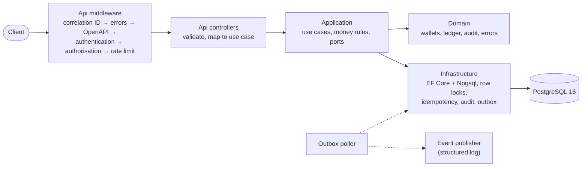
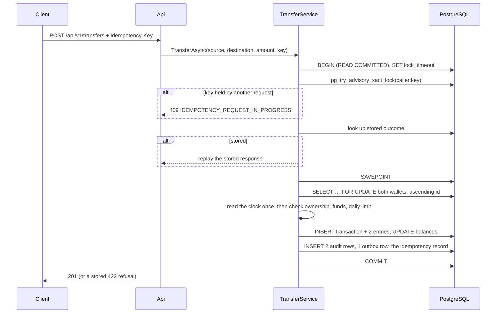

# NovaWallet Ledger Service

A wallet ledger for the NovaPay super-app: NGN wallets, inbound credits, wallet-to-wallet
transfers, statements and an audit trail. Money is integer kobo end to end, and the hard rules (no
negative balance, no double spend, no double processing, a daily limit) hold under concurrent load.

.NET 8, ASP.NET Core, EF Core 8 with Npgsql, PostgreSQL 16, xUnit with Testcontainers.

- [Overview](#overview)
- [Quick start](#quick-start)
- [API walkthrough](#api-walkthrough)
- [Architecture](#architecture)
- [Key decisions and trade-offs](#key-decisions-and-trade-offs)
- [Assumptions](#assumptions)
- [Testing](#testing)
- [Security](#security)
- [Regulatory notes](#regulatory-notes)
- [Not done and next steps](#not-done-and-next-steps)

How AI was used to build this: [AI_USAGE.md](AI_USAGE.md). The full design contract (API shapes,
error codes, database roles, concurrency rules): [docs/ARCHITECTURE.md](docs/ARCHITECTURE.md).

## Overview

The brief asks for the ledger behind a mobile wallet:

- create a wallet for a customer, starting at zero, and read its balance in kobo;
- credit a wallet from a simulated inbound NIP transfer;
- move money between wallets atomically, never overdrawing and never spending twice, even when
  requests race;
- make transfers idempotent through an `Idempotency-Key` header, and reject a reused key with a
  different payload;
- cap each wallet's outbound transfers per day, resetting at midnight WAT;
- show a paginated statement, newest first;
- record every balance change in an append-only audit trail that can be queried separately.

It should start with one command, protect its endpoints with JWT, return consistent errors, serve
an OpenAPI spec while running, and prove the concurrency rules with a test under load. The stretch
goals (readiness, correlation-ID logging, transfer rate limiting, a `TransferCompleted` outbox) are
all done.

| Endpoint | Who | What |
|---|---|---|
| `POST /api/v1/wallets` | customer (`wallet`) | Open my wallet |
| `GET /api/v1/wallets/{id}/balance` | customer (`wallet`) | My balance |
| `POST /api/v1/wallets/{id}/credits` | inbound-transfer system (`ledger:credit`) | Credit a wallet (simulated NIP) |
| `POST /api/v1/transfers` | customer (`wallet`) | Send money from my wallet |
| `GET /api/v1/wallets/{id}/statement` | customer (`wallet`) | My history, newest first |
| `GET /api/v1/audit` | auditor (`audit:read`) | The audit trail |
| `POST /dev/token` | anyone, Development only | Mint a test token |
| `GET /health/live`, `GET /health/ready` | anyone | Liveness, readiness |
| `GET /swagger` | anyone | Swagger UI and the OpenAPI document |

## Quick start

You need Docker (with Compose) and curl. No .NET SDK.

```bash
git clone https://github.com/Shield01/Nova-Wallet-Ledger-Service.git
cd Nova-Wallet-Ledger-Service
docker compose up --build
```

This starts PostgreSQL, runs the migrations once (the `migrator` service exits when done), then
starts the API on port 8080. In another terminal:

```bash
curl -s http://localhost:8080/health/ready
# {"status":"Healthy"}
```

Swagger UI is at <http://localhost:8080/swagger>. Get a token from `POST /dev/token` there, then
press **Authorize**.

To start again from an empty database: `docker compose down -v`.

The compose file carries development-only defaults for the database passwords and the token
signing key. Override them with environment variables or a `.env` file (see `.env.example`).

## API walkthrough

Every command below was run against a fresh `docker compose up`. Run them in order in one shell;
they keep ids in shell variables. `./scripts/smoke-test.sh` runs the same journey and checks every
status code.

### Tokens

The development issuer mints a token for any subject and scope. A customer token never carries
`ledger:credit`, so a customer can't credit their own wallet.

```bash
BASE=http://localhost:8080
token() {  # token <subject> <scope>
  curl -s -X POST "$BASE/dev/token" -H 'Content-Type: application/json' \
    -d "{\"subject\":\"$1\",\"scopes\":[\"$2\"]}" | sed -E 's/.*"accessToken":"([^"]+)".*/\1/'
}
ALICE=$(token alice wallet)
BOB=$(token bob wallet)
NIP=$(token nip-gateway ledger:credit)
AUDITOR=$(token auditor-1 audit:read)
```

### Open two wallets

The `customerId` must equal the token's subject.

```bash
A=$(curl -s -X POST "$BASE/api/v1/wallets" -H "Authorization: Bearer $ALICE" \
  -H 'Content-Type: application/json' -d '{"customerId":"alice"}' | sed -E 's/.*"walletId":"([^"]+)".*/\1/')
B=$(curl -s -X POST "$BASE/api/v1/wallets" -H "Authorization: Bearer $BOB" \
  -H 'Content-Type: application/json' -d '{"customerId":"bob"}' | sed -E 's/.*"walletId":"([^"]+)".*/\1/')
echo "Alice: $A  Bob: $B"
```

A second wallet for the same customer is `409 WALLET_ALREADY_EXISTS`, with the existing id in
`existingWalletId`.

### Credit Alice ₦50,000 (an inbound NIP transfer)

```bash
curl -s -X POST "$BASE/api/v1/wallets/$A/credits" -H "Authorization: Bearer $NIP" \
  -H 'Content-Type: application/json' -H 'Idempotency-Key: nip-session-0001' \
  -d '{"amountKobo":5000000}'
```

```json
{"transactionId":"b90b9098-…","walletId":"e2b69011-…","type":"CREDIT","amountKobo":5000000,"balanceAfterKobo":5000000,"createdAt":"2026-10-18T07:21:43.141054+00:00"}
```

Credits take an `Idempotency-Key` too: it stands in for the NIP session id, because NIP can
deliver the same inbound credit twice.

### Check the balance

```bash
curl -s "$BASE/api/v1/wallets/$A/balance" -H "Authorization: Bearer $ALICE"
# {"walletId":"…","balanceKobo":5000000,"currency":"NGN","asOf":"…"}
```

Bob asking for Alice's wallet gets `404 WALLET_NOT_FOUND`, the same as for a wallet that doesn't
exist.

### Send Bob ₦12,500, then retry the same request

```bash
curl -s -i -X POST "$BASE/api/v1/transfers" -H "Authorization: Bearer $ALICE" \
  -H 'Content-Type: application/json' -H 'Idempotency-Key: pay-bob-0001' \
  -d "{\"sourceWalletId\":\"$A\",\"destinationWalletId\":\"$B\",\"amountKobo\":1250000}"
```

`201` with `{"transferId":"…","sourceWalletId":"…","destinationWalletId":"…","amountKobo":1250000,"sourceBalanceAfterKobo":3750000,"createdAt":"…"}`.
Run the same command again: the response is the same `201` and body, plus the header
`Idempotent-Replayed: true`, and no money moves. The same key with a different amount is
`422 IDEMPOTENCY_KEY_REUSED`.

### A refusal: more than the balance

```bash
curl -s -X POST "$BASE/api/v1/transfers" -H "Authorization: Bearer $ALICE" \
  -H 'Content-Type: application/json' -H 'Idempotency-Key: too-much-0001' \
  -d "{\"sourceWalletId\":\"$A\",\"destinationWalletId\":\"$B\",\"amountKobo\":999999999}"
```

```json
{"type":"https://novawallet.example/errors/insufficient-funds","title":"Insufficient funds.","status":422,"detail":"The source wallet's balance is lower than the amount.","instance":"/api/v1/transfers","code":"INSUFFICIENT_FUNDS","traceId":"a6dc42ad…","correlationId":"21cde7d1…"}
```

Every error is RFC 7807 Problem Details with a stable `code`. The 19 codes are listed in
[docs/ARCHITECTURE.md](docs/ARCHITECTURE.md#errors-rfc-7807-problem-details). A transfer that would
take the day's total over ₦500,000 is `422 DAILY_LIMIT_EXCEEDED` with `dailyLimitKobo` and
`remainingKobo`.

### Alice's statement

```bash
curl -s "$BASE/api/v1/wallets/$A/statement?limit=20" -H "Authorization: Bearer $ALICE"
```

```json
{"walletId":"…","items":[
  {"entryId":7,"transactionId":"7dfa2af7-…","type":"TRANSFER_OUT","direction":"DEBIT","amountKobo":1250000,"balanceAfterKobo":3750000,"counterpartyWalletId":"…","createdAt":"…"},
  {"entryId":6,"transactionId":"b90b9098-…","type":"CREDIT","direction":"CREDIT","amountKobo":5000000,"balanceAfterKobo":5000000,"counterpartyWalletId":null,"createdAt":"…"}],
 "nextCursor":null}
```

Pass `nextCursor` back as `cursor` for the next page. Pages don't repeat or skip entries even when
new ones arrive while paging.

### The audit trail, over HTTP and in SQL

```bash
curl -s "$BASE/api/v1/audit?walletId=$A" -H "Authorization: Bearer $AUDITOR"
```

Straight from the database (every balance change, including the settlement account's side):

```bash
docker compose exec db psql -U postgres -d novawallet -c \
  "SELECT occurred_at, action, wallet_id, amount_kobo, balance_before_kobo, balance_after_kobo, actor, correlation_id
   FROM audit_log ORDER BY id DESC LIMIT 10;"
```

The database itself refuses to change history, even for the table owner:

```bash
docker compose exec db psql -U novawallet_owner -d novawallet -c \
  "UPDATE audit_log SET amount_kobo = amount_kobo WHERE id = 1;"
# ERROR:  audit_log is append-only: UPDATE is not allowed
```

The outbox and its delivery are visible the same way:

```bash
docker compose exec db psql -U postgres -d novawallet -c \
  "SELECT type, payload->>'transferId' AS transfer_id, published_at FROM outbox_messages;"
docker compose logs api | grep 'Published TransferCompleted'
```

## Architecture

Four projects with dependencies pointing inwards. Architecture tests fail the build if a layer
reaches outwards, or if `float`, `double` or `decimal` appears near money.



| Project | Owns |
|---|---|
| `src/NovaWallet.Domain` | Entities, value rules, error codes, `Result<T>` |
| `src/NovaWallet.Application` | Use cases and rules; ports for persistence, time, caller, correlation. No EF Core, no ASP.NET |
| `src/NovaWallet.Infrastructure` | `LedgerDbContext`, migrations, port implementations, outbox dispatcher |
| `src/NovaWallet.Api` | Composition root, controllers, auth, Problem Details, middleware, OpenAPI |
| `tests/NovaWallet.UnitTests` | Domain rules and architecture tests |
| `tests/NovaWallet.IntegrationTests` | HTTP tests on real PostgreSQL, including the load test |

A transfer is one database transaction from start to finish:



A refusal rolls back to the savepoint, so nothing the operation wrote survives; refusals that are
final outcomes (funds, limit, same wallet, unknown destination or source) are then stored for
replay.

## Key decisions and trade-offs

**Pessimistic row locks, not optimistic concurrency or `SERIALIZABLE`.** Every money use case locks
the wallet rows it touches with `SELECT … FOR UPDATE`, in ascending id order, before reading a
balance. Ordered locking rules out deadlocks between opposite-direction transfers. Optimistic
version checks would turn contention into retries the client sees as failures, and `SERIALIZABLE`
would need a retry loop around every use case for serialization failures. Locks make concurrent
transfers from one wallet queue up, which is exactly the behaviour a ledger wants. Waits are
bounded by `lock_timeout` (5 s), which surfaces as `503`, so a stuck transaction can't pile up
requests. The daily-limit check runs under the same lock, so two racing transfers can't both fit
under the limit.

**Idempotency inside the money transaction.** The key is scoped to the caller. An advisory lock on
`caller:key` makes a second concurrent request with the same key fail fast with `409`, rather than
waiting and then double-posting. The outcome is stored in the same transaction as the writes, so
there is never a moved-money-but-no-record state. A replay returns the original status and body
with `Idempotent-Replayed: true`. The same key with a different body is `422`. Final refusals
(insufficient funds, the limit) are stored too, so retrying a refused payment with the same key
gives the same refusal. The client contract: after a timeout, a 5xx or a 409, retry with the
**same** key; use a new key only for a new payment. Validation errors, 401/403, 429 and 5xx are not
stored, because nothing happened.

**Double entry with a settlement account.** Every movement is a transaction with two entries that
sum to zero. Inbound credits come from a `NIP_INBOUND_SETTLEMENT` system account, so the whole
ledger always sums to zero and every naira on a customer wallet has a source. The cost: every credit
locks that one row, so credits are serialised system-wide. That's fine at this scale; production
would shard settlement accounts or derive the settlement balance from entries instead of a hot row.

**Running balance on the wallet row, checked against the entries.** `balance_kobo` is updated in
the same transaction as the entries, each entry stores `balance_after_kobo`, and a `CHECK` keeps
customer balances at zero or above as a last line of defence. Tests assert after every money test
that each balance equals the sum of its entries.

**An audit trail the database protects.** `audit_log` is separate from the ledger and written in
the same transaction. Triggers reject `UPDATE`, `DELETE` and `TRUNCATE`; the runtime role only has
`SELECT` and `INSERT`; the table owner isn't a superuser, so it can't switch triggers off with
`session_replication_role`. The limit: the owner can still drop a trigger in a migration. Splitting
the migration role from the table owner and hash-chaining rows would close that.

**A transactional outbox for `TransferCompleted`.** The event is written in the transfer's
transaction, so it exists if and only if the transfer committed. A background poller claims rows
with `FOR UPDATE SKIP LOCKED` (safe with several instances), publishes through a port (a structured
log line here) and records success or failure, stopping after 10 failed attempts. Delivery is at
least once; consumers de-duplicate on `eventId`. The poll holds its row locks while publishing,
which is fine for a log line; with a real broker, publish outside the transaction under a claim
lease.

**WAT as a fixed UTC+1 offset.** Nigeria has no daylight saving, so the day is
`[00:00 WAT, next 00:00 WAT)`, computed from the injected clock and compared in UTC. The interval
is half-open, so no instant at midnight falls between two days.

**404, not 403, for someone else's wallet.** Returning 403 would confirm the wallet exists. A
transfer to a destination that doesn't exist is the exception (`422`), because the payer has to be
told.

**HS256 with a development issuer.** The brief allows a mock issuer. `POST /dev/token` exists only
in Development, refuses to combine `wallet` with `ledger:credit`, and the service won't start
outside Development with the committed development key. With HS256 whoever verifies can also mint,
so production would use an asymmetric key from a real identity provider.

**Per-instance rate limiting.** Ten transfer requests per minute per customer, in memory. Several
instances would each allow ten; a shared store (Redis) would fix that. The limiter runs after
authentication, so a bad token never uses up someone's permits.

**Amounts as `long` kobo, capped at 2^53 − 1.** No floating point anywhere money flows, `checked`
arithmetic so an overflow throws instead of wrapping, and a cap at the largest integer JSON clients
read exactly. Numbers sent as strings are rejected.

**Least-privilege database roles.** Migrations run once as `novawallet_owner`; the API connects as
`novawallet_app`, which can append to the ledger and audit trail but never update or delete them,
and can update only `wallets.balance_kobo` and the outbox's delivery columns.

## Assumptions

Where the brief left room, these choices were made:

1. .NET 8 (LTS), ASP.NET Core and PostgreSQL; the service and its database start from
   `docker compose up`.
2. One public GitHub repository, `Shield01/Nova-Wallet-Ledger-Service`, with GitHub Issues as the
   tracker.
3. One NGN wallet per customer id; a second is `409` with the existing wallet's id. The customer id
   is opaque: no names, BVN, NIN or phone numbers are stored or logged.
4. Access comes from token claims: `sub` is the customer id. Customers open, read and send only
   from their own wallet. Crediting needs `ledger:credit`, held by the inbound-transfer system and
   never by a customer. Reading the audit trail needs `audit:read`.
5. The mock issuer is an endpoint in the service, on only in Development, signing with a key from
   the environment.
6. Double entry: every movement posts balanced entries, and credits post against an internal
   settlement account.
7. `Idempotency-Key` is required on transfers and scoped to the caller: same key and body replays,
   different body is `422`, a request still running is `409`. Final refusals are stored and
   replayed. Status codes follow the IETF Idempotency-Key draft.
8. Credits take an `Idempotency-Key` under the same rules, standing in for the NIP session id.
9. The daily limit defaults to ₦500,000 and is configurable. It counts successful outbound
   transfers in the current Lagos calendar day. A transfer that would go over is refused in full;
   reaching the limit exactly is allowed.
10. Amounts are positive whole kobo. Transfers to the same wallet or to a missing wallet are
    refused.
11. The statement uses cursor pagination (default 20, at most 100), newest first, showing type,
    direction, amount, balance after, counterparty and time.
12. The audit trail is its own table, written in the same transaction as the change, and the
    database refuses edits to it. It can be read with SQL and through an `audit:read` endpoint.
13. `TransferCompleted` goes through an outbox to a log-based publisher; no broker is added.
14. Rate limit: 10 transfer requests per minute per customer, configurable; over it is `429` with
    `Retry-After`.
15. No reversal endpoint. "Reversal" in the tests means a failed operation leaves nothing posted.
16. Out of scope: KYC tiers, USSD, real NIP, fees, other currencies, freezing or closing wallets.
17. Build order: the hard constraints first, then health, logging and rate limiting, the outbox
    last.
18. The presentation deck is separate from the repository.

Product decisions taken while turning the brief into stories:

- When a transfer fails both the balance and the limit check, `INSUFFICIENT_FUNDS` wins. The full
  refusal order is validation → idempotency key → idempotency replay or conflict → unknown or
  not-owned source → same wallet → unknown destination → funds → daily limit.
- Unknown routes and malformed ids are `404 NOT_FOUND` for authenticated callers. Anonymous callers
  get `401` for any route not marked anonymous, so the route map isn't revealed. `405` and `415`
  have their own codes.
- A replay re-stamps `traceId`, `correlationId` and `instance` for the current request; the rest of
  the response is identical to the original.
- Money arithmetic is `checked`. "Now" is read once per use case, after the locks are held.
- The settlement account row stays locked by every credit, with lock waits bounded (`503` on
  timeout).
- Correlation-ID logging came before the audit trail, so every audit row carries a correlation id.
- The development database passwords and signing key live in `docker-compose.yml`, clearly
  labelled, each overridable. Production compares the signing key with a fingerprint of the
  development default and refuses it.
- Token issuing and validation use the wall clock (the JWT library validates against it); ledger
  timestamps and the daily window use the injected clock.
- Outbox events carry an `eventId`, and failed publishes stop after `Outbox:MaxAttempts`.

## Testing

```bash
dotnet test NovaWallet.sln
```

You need the .NET 8 SDK and Docker. The integration tests start one `postgres:16-alpine`
container per run (Testcontainers), create the same two roles the compose init script creates,
give every test class its own migrated database, and run the API in memory against it, connecting
as the restricted runtime role. To use an existing PostgreSQL server instead of Docker, set
`NOVAWALLET_TEST_DB` to a connection string for a login that can create databases and roles.

| Suite | Count | Covers |
|---|---|---|
| Unit | 18 | Layer dependencies, error codes, idempotency key rules, WAT day boundaries |
| Integration | 242 | Every endpoint and error code, auth and startup guards, idempotency races, the audit trail's database protection, outbox delivery, readiness, rate limiting, the load test |

After every test that moves money, the suite checks the ledger invariants in SQL: every
transaction sums to zero, every balance equals the sum of its entries, no customer balance is
negative, and the whole ledger sums to zero.

**The load test.** Only the concurrency proof:

```bash
dotnet test NovaWallet.sln --filter Category=Load
```

It sends 500 transfers at parallelism 32 across ten wallets from a fixed seed, with one in ten
requests repeating an earlier key. It fails unless the run produced funds refusals, limit refusals
and replays, then checks: no 5xx, no negative balance, balances equal their entries, one ledger
transaction, two audit rows and one outbox event per successful key, and no wallet over the daily
limit. A second test fires 25 identical same-key requests at once and expects exactly one
transfer. Other tests cover 50 concurrent transfers against a balance that covers 20 (exactly 20
succeed) and opposite-direction transfers at once (no deadlock).

**Against the running stack.** With `docker compose up` running:

```bash
./scripts/smoke-test.sh
```

**CI.** GitHub Actions runs format, build and every test on each pull request and push to `main`,
and a second job builds the real image with `docker compose up --build`, then runs the smoke test
against it.

## Security

- **Authentication.** JWT bearer, HS256 only, with issuer, audience and lifetime validated (15
  minute tokens, 30 s skew). A fallback policy means every endpoint needs a caller unless it is
  explicitly anonymous. Failed validation returns a bare `WWW-Authenticate: Bearer`, never the
  reason.
- **Authorisation.** Three scopes, one per actor, and every scoped endpoint requires a `sub` claim.
  Ownership is checked against `sub` in the use case, inside the transaction.
- **Startup guards.** The service refuses to start with a missing or short signing key, with the dev
  issuer on outside Development, or outside Development with the committed development key.
- **Input.** Strict JSON number handling; amounts, ids, cursor and limit validated; idempotency keys
  limited to 128 printable ASCII characters.
- **Errors.** Problem Details only; unexpected exceptions become a generic 500 with a trace id,
  never a stack trace or internal message.
- **Data.** Only an opaque customer id is stored. Logs never contain request bodies, tokens,
  signing keys or connection strings (tests check tokens and bodies). Wallet ids are random UUIDs.
- **Database.** Separate migration and runtime roles; the runtime role can't alter or delete ledger
  or audit rows. The API port is bound to `127.0.0.1` in compose.
- **Abuse.** Per-customer transfer rate limit; bounded lock waits; the anonymous readiness probe
  reuses its answer for a second and runs one database check at a time, so a flood of probes can't
  drain the connection pool.

## Regulatory notes

These are design notes, not legal advice.

- **Kobo storage.** Amounts are stored and computed as integer kobo, so there is no rounding drift
  between the ledger, statements and anything reconciled against NIBSS settlement reports.
- **NDPA data minimisation.** The service holds an opaque customer id and nothing else about the
  person: no name, BVN, NIN or phone number. Logs carry ids and correlation ids, not bodies. Customer
  data lives in the KYC/identity system, which this service never needs to read.
- **KYC tier limits.** CBN's tiered KYC framework caps daily transactions and balances by tier.
  Today the daily limit is one configured value. Tiers would plug into the transfer use case where
  the limit is read (`TransferService` via `LimitSettings`): look up the wallet's tier and apply its
  daily and per-transaction caps, plus a maximum-balance check on credits, all under the same row
  lock.
- **Consumer protection.** CBN's consumer-protection rules expect clear disclosure, fair treatment
  and prompt resolution of failed or disputed transactions. The touchpoints here: refusals carry a
  plain reason and a code; idempotent retries stop a customer being debited twice; every balance
  change has an immutable audit row with the actor and correlation id, which is what a dispute
  investigation needs; and the statement shows the customer every movement with its balance after.

## Not done and next steps

- A real identity provider with asymmetric keys (JWKS) instead of HS256 and the dev issuer.
- A TTL for idempotency records. They don't expire in this build; a scheduled purge after, say, 24
  hours to 7 days (longer than any client retry window) would keep the table bounded.
- Tamper evidence for the audit trail (a hash chain) and a migration role separate from the table
  owner.
- Settlement-account sharding, or deriving its balance from entries, to remove the credit hot row.
- A shared rate-limit store for more than one instance.
- Outbox publishing outside the transaction with claim leases, and a real broker.
- KYC tier limits, a maximum balance, fees, reversals and dispute flows, wallet freeze and close.
- Metrics and trace export (OpenTelemetry), and statement filters by date range.
